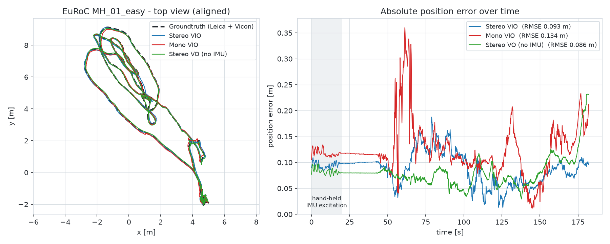
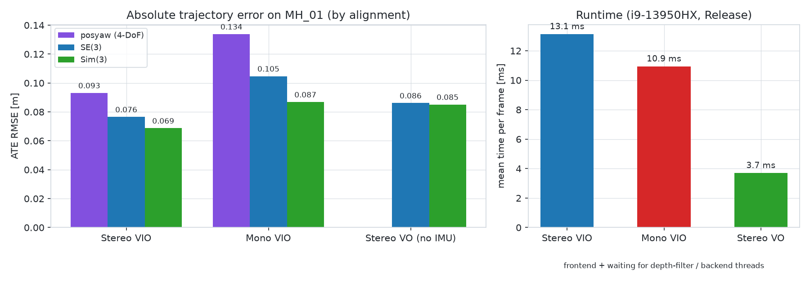
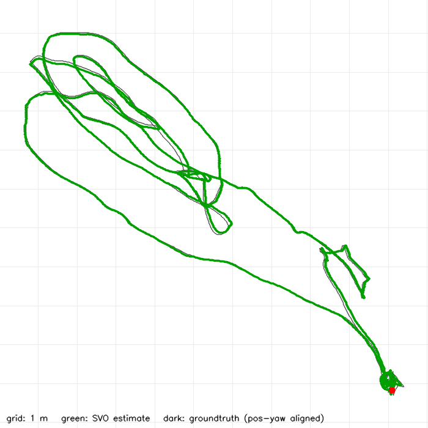
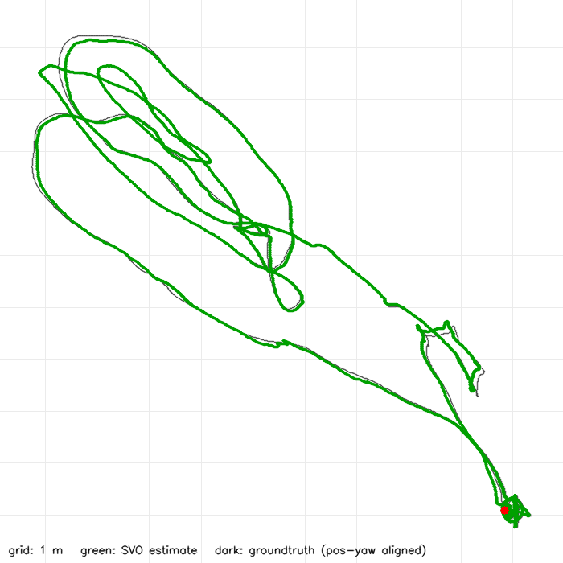
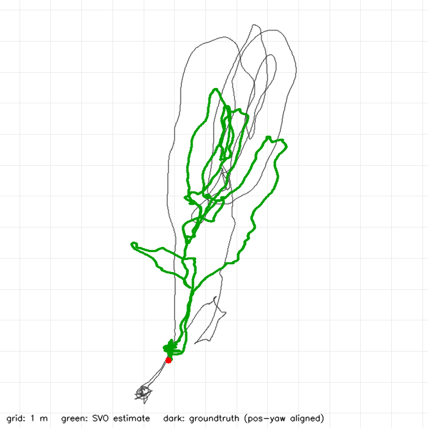

# svo-pro-standalone

[](LICENSE)   

**[SVO Pro](https://github.com/uzh-rpg/rpg_svo_pro_open) semi-direct visual(-inertial) odometry as a standalone C++ program — no ROS, no catkin, no Ubuntu.**

SVO Pro (UZH Robotics and Perception Group) is a fast semi-direct visual odometry front-end with an optional sliding-window visual-inertial back-end built on Ceres. Upstream it ships as a set of ROS 1 / catkin packages, which in practice means an Ubuntu machine (or Docker) with a matching ROS distribution — and ROS 1 reached end-of-life in May 2025. This repository builds the SVO Pro core libraries with plain CMake, replaces the `svo_ros` node with a small command-line runner that reads EuRoC data directly from disk, and ports the back-end to Ceres 2.2, so the whole pipeline runs as one native executable — tested on **Windows 10/11 with Visual Studio 2022 (MSVC) and vcpkg**.

| Original SVO Pro | This repo | What it does |
|---|---|---|
| `svo_ros` node + launch files + rosbag | `svo_euroc.exe` | Runs SVO on an EuRoC/ASL folder, writes trajectories and an ATE report |
| `launch/frontend/euroc_*_frontend*.launch` | `config/euroc_frontend_{mono,stereo}.yaml` | Front-end only (VO) |
| `launch/vio/euroc_vio_*.launch` | `config/euroc_vio_{mono,stereo}.yaml` | Front-end + Ceres VIO back-end |
| `rpg_trajectory_evaluation` (Python) | built into `svo_euroc.exe` | ATE with posyaw / SE(3) / Sim(3) alignment |

Headline result on **EuRoC MH_01_easy**: stereo VIO reaches an ATE RMSE of **0.093 m** (posyaw alignment) / **0.077 m** (SE(3)), mono VIO **0.134 m** / **0.105 m**, at **3.7 – 13 ms per frame** on a laptop CPU. Full numbers are [below](#results-on-euroc-mh_01).

<picture>
  <source media="(prefers-color-scheme: dark)" srcset="docs/images/mh01_trajectory_dark.png">
  
</picture>

---

## Contents

- [Repository layout](#repository-layout)
- [Dependencies](#dependencies)
- [Build](#build)
- [Dataset](#dataset)
- [Usage](#usage)
- [Results on EuRoC MH_01](#results-on-euroc-mh_01)
- [Differences from the original SVO Pro](#differences-from-the-original-svo-pro)
- [Acknowledgements and license](#acknowledgements-and-license)

## Repository layout

```
svo-pro-standalone/
├── CMakeLists.txt, CMakePresets.json   # plain CMake build (no catkin), preset "windows-msvc"
├── app/                     # new code replacing svo_ros:
│   ├── svo_euroc.cpp        #   command-line runner (gflags)
│   ├── param_server.*       #   YAML parameters with the same names/defaults as rosparam
│   ├── svo_factory.*        #   builds frontend/backend/IMU handler from parameters
│   ├── euroc_dataset.*      #   EuRoC/ASL folder reader (images, IMU, groundtruth)
│   ├── visualizer_cv.*      #   OpenCV visualization instead of rviz
│   └── trajectory_eval.*    #   ATE (posyaw / SE3 / Sim3 alignment)
├── modules/                 # SVO Pro sources (svo, svo_common, svo_direct, svo_img_align,
│                            #   svo_tracker, svo_ceres_backend, svo_vio_common, vikit_*, rpg_common)
├── third_party/             # minkindr (header-only), fast (SSE2), opengv (subset used by SVO)
├── config/                  # EuRoC parameter files + calib/euroc_{mono,stereo}.yaml
├── scripts/
│   ├── setup_vcpkg.ps1      # installs all dependencies with vcpkg
│   ├── build.ps1            # configures + builds with the CMake preset
│   ├── run_euroc.ps1        # runs one configuration on one EuRoC sequence
│   └── make_readme_figure.py
├── docs/images/             # README figures
├── results/                 # reference runs on MH_01 (trajectories, ATE reports, plots)
└── .vscode/                 # build tasks and launch configurations for VS Code
```

`dataset/` (EuRoC data), `build/` and `tools/vcpkg/` (an optional private vcpkg) are created locally and are not part of the repository.

## Dependencies

| Dependency | Used for | Version tested |
|---|---|---|
| Visual Studio 2022 or Build Tools 2022 (MSVC v143, "Desktop development with C++") | C++17 compiler | MSVC 14.44 |
| CMake | build system (presets need ≥ 3.21) | 4.3 |
| Git | cloning this repository and vcpkg | – |
| [vcpkg](https://github.com/microsoft/vcpkg) packages, triplet `x64-windows`: | | vcpkg 2026-06 |
| &nbsp;&nbsp;`eigen3` | linear algebra | 5.0.1 (3.4 also fine) |
| &nbsp;&nbsp;`opencv4` | image I/O, pyramids, visualization | 4.12 |
| &nbsp;&nbsp;`ceres` | VIO back-end optimization (≥ 2.1, uses `ceres::Manifold`) | 2.2.0 |
| &nbsp;&nbsp;`glog`, `gflags` | logging, command-line flags | 0.7.1, 2.3.0 |
| &nbsp;&nbsp;`yaml-cpp` | parameter and calibration files | 0.9.0 |

Not needed: ROS, catkin, Boost, Python (except for the optional figure script), Docker, WSL, MSYS2 or Ubuntu.

### Install the dependencies

1. Install **Visual Studio 2022** (Community or Build Tools) with the *Desktop development with C++* workload, **CMake** ≥ 3.21 and **Git**.
2. Clone this repository and, from a PowerShell in its root, run:

```powershell
git clone https://github.com/rafal7466/svo-pro-standalone.git
cd svo-pro-standalone
powershell -ExecutionPolicy Bypass -File scripts\setup_vcpkg.ps1
```

The script uses your existing vcpkg if `VCPKG_ROOT` points to one; otherwise it clones and bootstraps a private copy into `tools\vcpkg`. It then runs

```powershell
vcpkg install eigen3 opencv4 ceres glog gflags yaml-cpp --triplet x64-windows
```

A first install compiles everything from source and takes roughly 30–60 minutes (≈ 10 GB); if the packages are already installed it finishes in seconds. To use a vcpkg in another location pass `-VcpkgRoot C:\path\to\vcpkg` and set `VCPKG_ROOT` to the same path.

> **Note:** the vcpkg copy that ships with Visual Studio (`…\VC\vcpkg`, set as `VCPKG_ROOT` inside the *Developer PowerShell*) only supports manifest mode and cannot be used here; the script ignores it and uses `tools\vcpkg` instead.

## Build

```powershell
powershell -ExecutionPolicy Bypass -File scripts\build.ps1
```

or manually:

```powershell
cmake --preset windows-msvc                      # Visual Studio 17 2022, x64, vcpkg toolchain
cmake --build build --config Release --parallel
```

The build produces `build\bin\Release\svo_euroc.exe`; vcpkg copies all required DLLs next to it, so the folder is self-contained. `CMakeLists.txt` finds vcpkg through `VCPKG_ROOT`, `tools\vcpkg`, `C:\vcpkg` or `%USERPROFILE%\vcpkg`; you can always override it with `-DCMAKE_TOOLCHAIN_FILE=<vcpkg>\scripts\buildsystems\vcpkg.cmake`. MSVC compiles 8 files in parallel per project (`-DSVO_MSVC_MP_JOBS=N` to change it; Eigen/Ceres-heavy files need 1–2 GB RAM each).

**VS Code:** open the folder with the *C/C++* and *CMake Tools* extensions, select the preset *Windows x64 - MSVC 2022 + vcpkg*, build with `Ctrl+Shift+B` and start one of the launch configurations (*SVO stereo VIO - MH_01*, …), which expect the data in `dataset\MH_01_easy`.

The project is plain CMake and also contains a `linux-release` preset (GCC/Clang with the same libraries from the system package manager), but only the Windows/MSVC path has been tested.

## Dataset

`svo_euroc.exe` reads the **EuRoC / ASL folder format** instead of rosbags:

```
<sequence>/mav0/
├── cam0/data.csv, cam0/data/<timestamp>.png, cam0/sensor.yaml
├── cam1/...
├── imu0/data.csv
└── state_groundtruth_estimate0/data.csv     # optional, used for the ATE report
```

All EuRoC files are hosted on the ETH Research Collection ([doi:10.3929/ethz-b-000690084](https://doi.org/10.3929/ethz-b-000690084), linked from the [EuRoC MAV dataset page](https://projects.asl.ethz.ch/datasets/euroc-mav/)). Download the **Machine Hall** archive (ASL format, not the rosbags), extract `MH_01_easy` into `dataset/` and extract its `.zip` in place if it contains one, so that you get:

```
dataset/MH_01_easy/mav0/{cam0, cam1, imu0, state_groundtruth_estimate0, ...}
```

The `--dataset` path may point either to the folder that contains `mav0/` or to `mav0/` itself; macOS `._*` files are ignored. Any other sequence or sensor setup works as long as it is stored in this format and a matching calibration file is provided (see `config/calib/`).

## Usage

### Quick start (PowerShell, EuRoC MH_01)

```powershell
# stereo VIO: stereo frontend + Ceres sliding-window backend   (~1 min)
powershell -ExecutionPolicy Bypass -File scripts\run_euroc.ps1 -Dataset dataset\MH_01_easy -Mode stereo_vio

# mono VIO
powershell -ExecutionPolicy Bypass -File scripts\run_euroc.ps1 -Dataset dataset\MH_01_easy -Mode mono_vio

# stereo VO without IMU (frontend only)
powershell -ExecutionPolicy Bypass -File scripts\run_euroc.ps1 -Dataset dataset\MH_01_easy -Mode stereo_vo
```

Add `-Viz` to show the OpenCV windows (tracked features and a top view; `q` quit, `Space` pause, `r` reset). Each run writes `results\<sequence>_<mono|stereo>_<vio|vo>\` and prints the ATE summary at the end.

### Direct command line

```powershell
.\build\bin\Release\svo_euroc.exe --dataset=dataset\MH_01_easy --config=config\euroc_vio_stereo.yaml
```

| Option | Default | Description |
|---|---|---|
| `--dataset` | – | EuRoC sequence (folder with `mav0/`, or `mav0/` itself) |
| `--config` | – | parameter file (`config/*.yaml`); same parameter names as the SVO Pro launch files |
| `--calib` | `calib_file` from the config | camera (+ IMU) calibration file |
| `--pipeline` | from `pipeline_is_stereo` | `mono` or `stereo` |
| `--output_dir` | `results` | output folder |
| `--viz` / `--wait_at_end` | `true` / `true` | OpenCV visualization; keep the windows open at the end |
| `--sync_threads` | `true` | after every frame wait for the depth-filter and backend threads ("fast real-time" behaviour at full speed) |
| `--realtime_factor` | `0` | 0 = as fast as possible, 1 = real time. ROS-like behaviour: `--sync_threads=false --realtime_factor=1` |
| `--start_frame`, `--max_frames` | `0`, `-1` | process only part of the sequence |
| `--params` | – | override parameters, e.g. `--params="max_fts=150,ceres_num_iterations=5"` |
| `--init_velocity`, `--init_velocity_file`, `--init_velocity_sigma` | –, –, `2` | initial body-frame velocity prior of the backend (to start in motion) |
| `--gps_aiding_duration`, `--gps_sigma_h`, `--gps_sigma_v` | `-1`, `2`, `4` | fuse the groundtruth positions as GPS for the first N seconds, then continue with SVO + IMU only |
| `--clahe`, `--image_scale` | `0`, `1` | CLAHE contrast enhancement; resize input images |
| `--v` | `0` | glog verbosity |

Run `svo_euroc.exe --help` for the complete list.

### Outputs (`results/<sequence>_<mono|stereo>_<vio|vo>/`)

| File | Content |
|---|---|
| `stamped_traj_estimate.txt` | frontend trajectory, TUM format `t tx ty tz qx qy qz qw` (body/IMU in world) |
| `stamped_traj_backend.txt` | optimized backend trajectory (VIO only) |
| `stamped_backend_speed_bias.txt` | backend velocity and IMU biases per frame (VIO only) |
| `traj_estimate_euroc.csv` | the same trajectory in EuRoC CSV format |
| `stamped_groundtruth.txt` | groundtruth in TUM format, ready for [evo](https://github.com/MichaelGrupp/evo) or `rpg_trajectory_evaluation` |
| `stamped_traj_*_aligned_{posyaw,se3}.txt` | estimate aligned to the groundtruth |
| `results.txt` | summary: frames, tracking losses, timing, ATE (posyaw / SE3 / Sim3) and every parameter used |
| `trajectory_top_view.png` | top view of estimate vs. groundtruth |

Cross-check with evo, for example:

```powershell
evo_ape tum results\MH_01_stereo_vio\stamped_groundtruth.txt results\MH_01_stereo_vio\stamped_traj_backend.txt -a -p
```

## Results on EuRoC MH_01

All runs below are stored in [`results/`](results/) (trajectories, aligned trajectories, `results.txt` with all parameters, top-view plots). They use the default configuration files of this repository on the full sequence (3682 stereo frames, ≈ 182 s), Release build, Intel i9-13950HX, `--sync_threads=true`.

<picture>
  <source media="(prefers-color-scheme: dark)" srcset="docs/images/mh01_ate_dark.png">
  
</picture>

### Absolute trajectory error (RMSE, m)

| Configuration | Config file | posyaw | SE(3) | Sim(3) (scale) | Tracking lost | Time / frame |
|---|---|---|---|---|---|---|
| Stereo VIO ([results](results/MH_01_stereo_vio/results.txt)) | `euroc_vio_stereo.yaml` | **0.093** | **0.077** | 0.069 (1.008) | 0× | 13.1 ms |
| Mono VIO ([results](results/MH_01_mono_vio/results.txt)) | `euroc_vio_mono.yaml` | 0.134 | 0.105 | 0.087 (1.014) | 2× | 10.9 ms |
| Stereo VO, no IMU ([results](results/MH_01_stereo_vo/results.txt)) | `euroc_frontend_stereo.yaml` | – | 0.086 | 0.085 (1.003) | 0× | 3.7 ms |

- VIO numbers are for the backend trajectory; the frontend trajectory is within 1 mm of it.
- *posyaw* aligns position and yaw only (4-DoF, the unobservable directions of VIO); *SE(3)* aligns the full 6-DoF pose; *Sim(3)* additionally estimates a scale.
- *Time / frame* is the frontend time plus waiting for the depth-filter and backend threads (`--sync_threads=true`); the frontend alone takes ≈ 1.5 ms (mono) to ≈ 3 ms (stereo).

### Top views written by `svo_euroc.exe`

| Stereo VIO | Mono VIO | Stereo VO |
|---|---|---|
|  |  |  |

### Notes

- **Run-to-run variation.** SVO Pro is multi-threaded (depth filter and backend run in their own threads), so results differ slightly between runs — the same happens with the original ROS version. Over repeated runs on a fresh clone: stereo VIO 0.09 – 0.14 m (posyaw), stereo VO 0.05 – 0.09 m (SE3), mono VIO 0.11 – 0.19 m (posyaw, median 0.140 m over 18 runs; SE3 median 0.112 m). The mono run stored in `results/` is close to that median.
- **Mono VIO initialization.** The first ≈ 20 s of MH_01 are hand-held motion to excite the IMU. With the upstream `vio_mono.yaml` values (`init_min_disparity: 30`, `backend_scale_stable_thresh: 0.02`) mono VIO initialized during this shaky phase and the backend diverged in 3 of 10 runs (errors of tens of metres). `config/euroc_vio_mono.yaml` therefore requires more disparity before initializing (`50`) and a stricter scale-stability check (`0.01`); with these values all 18 test runs converged. To reproduce the upstream behaviour use `--params="init_min_disparity=30,backend_scale_stable_thresh=0.02"`.
- The figures are regenerated from `results/` with `python scripts/make_readme_figure.py` (needs numpy and matplotlib).

## Differences from the original SVO Pro

- `svo_ros` (node, nodelet, rosparam, rviz visualizer, rosbag input) is replaced by `app/`: YAML parameters through `svo::ParamServer` with the same names and default values as `vk::param`, an EuRoC folder reader, OpenCV visualization and a built-in ATE evaluation. SVO's algorithms in `modules/` are unchanged.
- Ceres 2.2 removed `LocalParameterization`; the OKVIS-based backend classes now derive from `ceres::Manifold` (`local_parameterization_additional_interfaces.hpp`).
- The catkin dependencies `minkindr`, `fast` and `opengv` are vendored in `third_party/` (only the parts SVO needs).
- Portability for MSVC: Boost removed (`erf_inv` replaced), `dirent.h` / `termios` replaced by `std::filesystem`, `__attribute__((aligned))` → `alignas(16)`, SSE macros defined for MSVC.
- New runner features: start in motion with a velocity prior, temporary GPS aiding from the groundtruth, CLAHE and image scaling, deterministic thread synchronization.
- `config/euroc_vio_mono.yaml` uses a more conservative initialization than upstream (see [Notes](#notes)); the other parameter files keep the upstream values.
- Not included: loop closing (DBoW2) and the global map (GTSAM / iSAM2) — both optional in the original as well.

## Acknowledgements and license

This repository is a derivative of SVO Pro and is therefore released under the [GNU GPL v3](LICENSE), the license of the upstream code; attribution of the upstream components is in [NOTICE](NOTICE). To cite it, use GitHub's *Cite this repository* button (generated from [`CITATION.cff`](CITATION.cff)) and please also cite the original SVO papers listed below.

This work builds directly on **SVO Pro** by the Robotics and Perception Group, University of Zurich ([uzh-rpg/rpg_svo_pro_open](https://github.com/uzh-rpg/rpg_svo_pro_open)). The VIO backend is derived from **OKVIS** (BSD license); OpenGV and minkindr keep their own licenses in [`third_party/`](third_party/). If you use this code in academic work, please cite:

- C. Forster, Z. Zhang, M. Gassner, M. Werlberger, D. Scaramuzza, “SVO: Semidirect Visual Odometry for Monocular and Multicamera Systems,” IEEE Transactions on Robotics, 2017.
- C. Forster, M. Pizzoli, D. Scaramuzza, “SVO: Fast Semi-Direct Monocular Visual Odometry,” ICRA 2014.
- S. Leutenegger, S. Lynen, M. Bosse, R. Siegwart, P. Furgale, “Keyframe-based visual–inertial odometry using nonlinear optimization,” IJRR 2015.

EuRoC data: M. Burri et al., “The EuRoC micro aerial vehicle datasets,” IJRR 2016.

Author of the standalone C++ port: **Mohammadreza** ([@rafal7466](https://github.com/rafal7466)), Sharif University of Technology. See also [kalibr-standalone](https://github.com/rafal7466/kalibr-standalone) for Kalibr camera / camera–IMU calibration without ROS.
